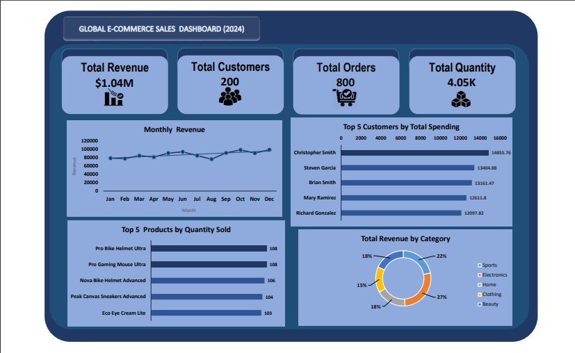

# Global E-Commerce Sales Analysis 2024

## Project Overview

This project uses PostgreSQL and Microsoft Excel to explore a global e-commerce dataset, examining sales performance, customer spending, purchasing behavior and product performance. An Excel dashboard presents selected results, while supplementary SQL analysis investigates product revenue contribution relative to sales volume.

## Tools

- **PostgreSQL:** Data exploration, joins, aggregations, CTEs, date functions and window functions.
- **Microsoft Excel:** Dashboard visualization.

## Dataset

The project uses four related tables:

| Table | Description |
|---|---|
| `customers` | Customer details, including city and country |
| `orders` | Order dates, customer IDs and recorded order amounts |
| `products` | Product names, categories and prices |
| `order_items` | Products and quantities associated with orders |

The supplied dataset contains 200 customers, 50 products, 800 orders and 2,017 order item records.

## SQL Analysis

The SQL queries are organized into six files:

- **Data Exploration:** Summarizes customers, orders, revenue, and quantities sold.
- **Sales Analysis:** Examines monthly revenue trends, cumulative revenue, and order volumes by country.
- **Customer Analysis:** Compares total customer spending, average order values, spending above the customer average and top spending customers by country.
- **Behavioral Analysis:** Examines the time between successive orders and compares order amounts within each customer's purchase history.
- **Product Analysis:** Investigates product sales volume, product revenue, leading products within categories and revenue distribution across categories.
- **Supplementary SQL Analysis:** Compares product revenue share with quantity share to investigate differences between revenue contribution and sales volume.

## Key Findings

### 1. Revenue was relatively stable throughout the year

Total recorded revenue was **$1,043,684.51**, with average monthly revenue of approximately **$86,973.71**. December recorded the highest monthly revenue at **$98,602.59**, while August recorded the lowest at **$76,095.58**. Monthly revenue had a coefficient of variation of approximately **8.6%**, indicating relatively limited variation around the monthly average. December revenue was about **25.7% higher than January**, although revenue did not rise consistently month to month.

### 2. Revenue was distributed across customers, products and categories

The five highest spending customers contributed approximately **6.34% of total revenue**. The highest revenue product contributed approximately **4.67%**, while Electronics was the largest revenue generating category at approximately **27.05%**. These results indicate that no single customer, product, or category dominated recorded revenue.

### 3. Product sales volume did not always align with revenue contribution

Comparing products ranked by quantity sold with products ranked by revenue revealed differences in their relative contributions. Some products accounted for a larger share of units sold than of revenue, while others contributed a larger share of revenue relative to their unit share. This supports evaluating product performance using both sales volume and revenue rather than either metric alone.

The supplementary SQL queries support this finding and extend the analysis beyond the dashboard visuals.

## Dashboard

The dashboard provides a static visual summary of selected results, including key performance indicators and charts covering:

- Monthly revenue trends
- Top five customers by spending
- Top five products by quantity sold
- Revenue by product category



The dashboard is included as a PNG image. The SQL files provide the queries behind the analysis and additional investigations not represented by a separate dashboard visual.

## Repository Structure

```text
global-ecommerce-sales-analysis-2024/
├── README.md
├── dashboard/
│   └── dashboard-screenshot.png
├── dataset/
│   ├── customers.csv
│   ├── orders.csv
│   ├── products.csv
│   └── order_items.csv
└── sql_queries/
    ├── data_exploration.sql
    ├── sales_analysis.sql
    ├── customer_analysis.sql
    ├── behavioral_analysis.sql
    ├── product_analysis.sql
    └── supplementary_SQL_analysis.sql
```

## Limitations

- The analysis focuses on recorded revenue and sales volume. Product cost and expense data were not available, so profit and profit margins could not be assessed.
- The product comparison identifies differences between revenue share and quantity share; it does not establish why individual products performed differently.
- The dashboard presents selected results rather than every SQL query and investigation.

## Conclusion

This project demonstrates how SQL can be used to explore an e-commerce dataset, investigate sales and customer patterns and develop evidence based findings. The dashboard summarizes selected results, while supplementary SQL queries support deeper investigation beyond the visualized metrics.
